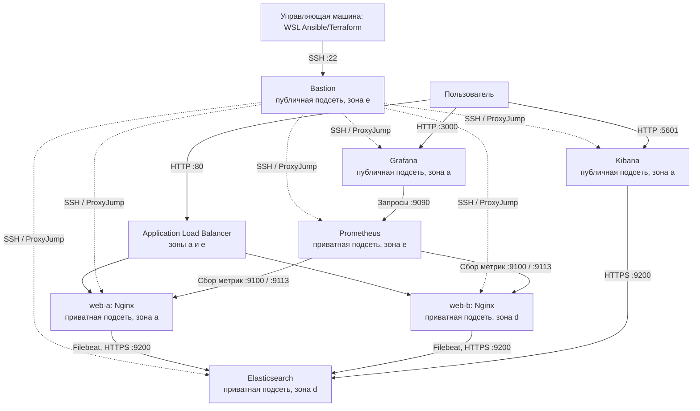
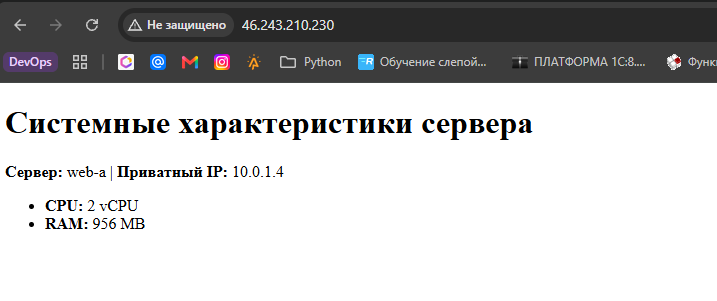
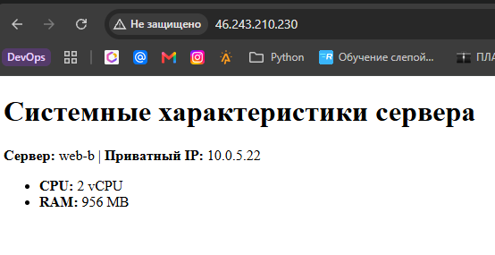
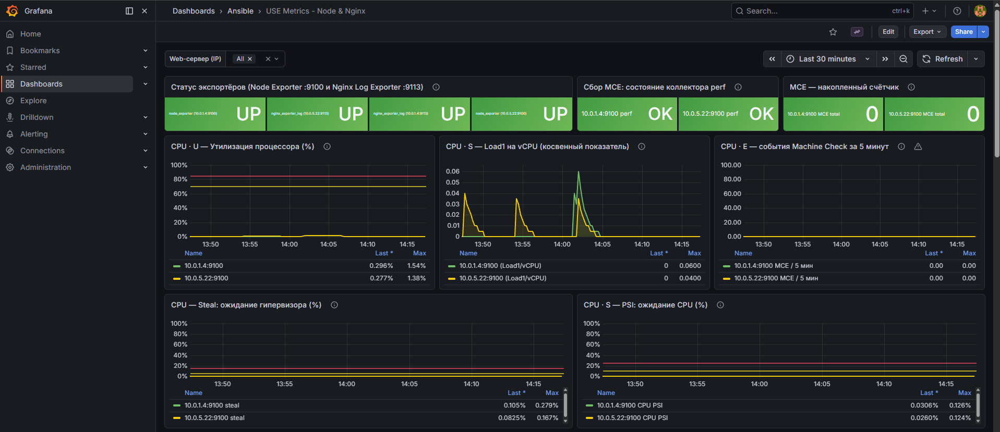
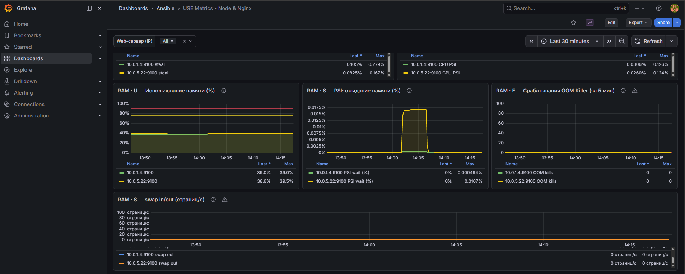
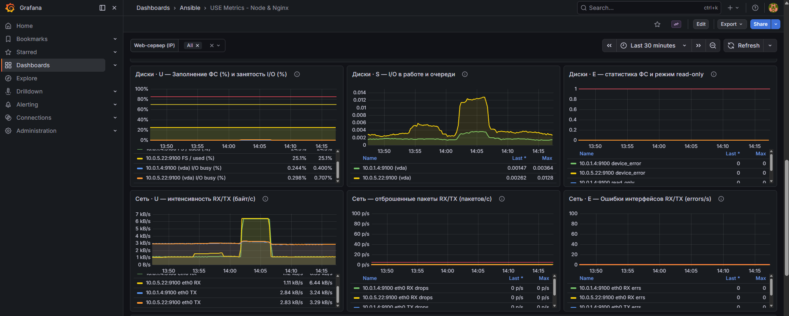
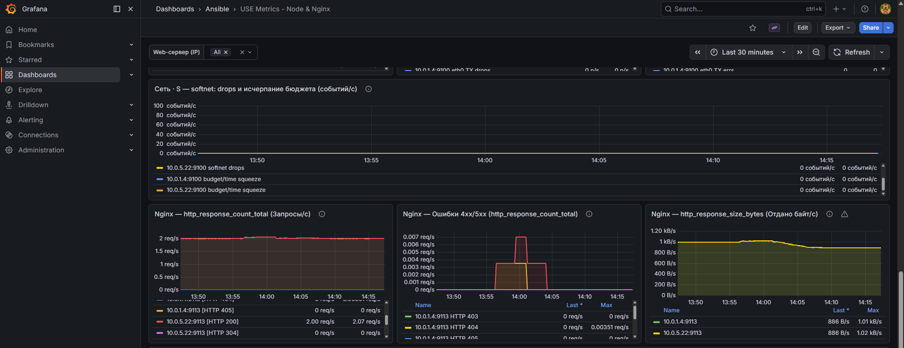
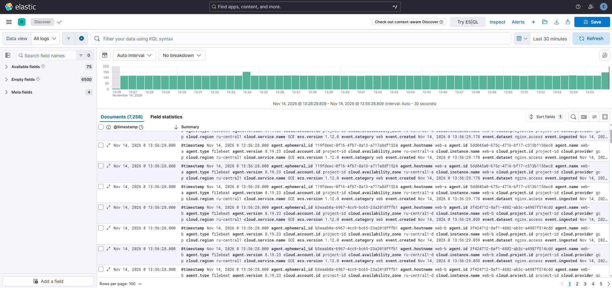
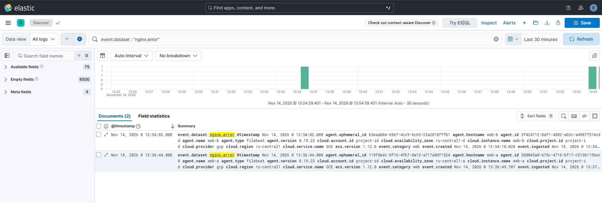

#  Курсовая работа на профессии "DevOps-инженер с нуля" Ершова А.О.

Содержание
==========
* [Результаты выполнения и скриншоты](#результаты-выполнения)
* [Задача](#задача)
* [Инфраструктура](#инфраструктура)
    * [Сайт](#сайт)
    * [Мониторинг](#мониторинг)
    * [Логи](#логи)
    * [Сеть](#сеть)
    * [Резервное копирование](#резервное-копирование)
    * [Дополнительно](#дополнительно)
* [Выполнение работы](#выполнение-работы)
* [Критерии сдачи](#критерии-сдачи)
* [Как правильно задавать вопросы дипломному руководителю](#как-правильно-задавать-вопросы-дипломному-руководителю)
* [Мои результаты выполнения](#мои-результаты-выполнения)
---------
## Задача
Ключевая задача - разработать отказоустойчивую инфраструктуру для сайта, включающую мониторинг, сбор логов и резервное копирование основных данных. Инфраструктура должна размещаться в [Yandex Cloud](https://cloud.yandex.com/).

**Примечание**: в курсовой работе используется система мониторинга Prometheus. Вместо Prometheus вы можете использовать Zabbix. Задание для курсовой работы с использованием Zabbix находится по [ссылке](https://github.com/netology-code/fops-sysadm-diplom/blob/diplom-zabbix/README.md).

**Перед началом работы над дипломным заданием изучите [Инструкция по экономии облачных ресурсов](https://github.com/netology-code/devops-materials/blob/master/cloudwork.MD).**

## Инфраструктура
Для развертки инфраструктуры используйте Terraform и Ansible.

Параметры виртуальной машины (ВМ) подбирайте по потребностям сервисов, которые будут на ней работать.

Ознакомьтесь со всеми пунктами из этой секции, не беритесь сразу выполнять задание, не дочитав до конца. Пункты взаимосвязаны и могут влиять друг на друга.

### Сайт
Создайте две ВМ в разных зонах, установите на них сервер nginx, если его там нет. ОС и содержимое ВМ должно быть идентичным, это будут наши веб-сервера.

Используйте набор статичных файлов для сайта. Можно переиспользовать сайт из домашнего задания.

Создайте [Target Group](https://cloud.yandex.com/docs/application-load-balancer/concepts/target-group), включите в нее две созданных ВМ.

Создайте [Backend Group](https://cloud.yandex.com/docs/application-load-balancer/concepts/backend-group), настройте backends на target group, ранее созданную. Настройте healthcheck на корень (/) и порт 80, протокол HTTP.

Создайте [HTTP router](https://cloud.yandex.com/docs/application-load-balancer/concepts/http-router). Путь укажите - /, backend group - созданную ранее.

Создайте [Application load balancer](https://cloud.yandex.com/en/docs/application-load-balancer/) для распределения трафика на веб-сервера, созданные ранее. Укажите HTTP router, созданный ранее, задайте listener тип auto, порт 80.

Протестируйте сайт
`curl -v <публичный IP балансера>:80`

### Мониторинг
Создайте ВМ, разверните на ней Prometheus. На каждую ВМ из веб-серверов установите Node Exporter и [Nginx Log Exporter](https://github.com/martin-helmich/prometheus-nginxlog-exporter). Настройте Prometheus на сбор метрик с этих exporter.

Создайте ВМ, установите туда Grafana. Настройте ее на взаимодействие с ранее развернутым Prometheus. Настройте дешборды с отображением метрик, минимальный набор - Utilization, Saturation, Errors для CPU, RAM, диски, сеть, http_response_count_total, http_response_size_bytes. Добавьте необходимые [tresholds](https://grafana.com/docs/grafana/latest/panels/thresholds/) на соответствующие графики.

### Логи
Cоздайте ВМ, разверните на ней Elasticsearch. Установите filebeat в ВМ к веб-серверам, настройте на отправку access.log, error.log nginx в Elasticsearch.

Создайте ВМ, разверните на ней Kibana, сконфигурируйте соединение с Elasticsearch.

### Сеть
Разверните один VPC. Сервера web, Prometheus, Elasticsearch поместите в приватные подсети. Сервера Grafana, Kibana, application load balancer определите в публичную подсеть.

Настройте [Security Groups](https://cloud.yandex.com/docs/vpc/concepts/security-groups) соответствующих сервисов на входящий трафик только к нужным портам.

Настройте ВМ с публичным адресом, в которой будет открыт только один порт - ssh. Настройте все security groups на разрешение входящего ssh из этой security group. Эта вм будет реализовывать концепцию bastion host. Потом можно будет подключаться по ssh ко всем хостам через этот хост.

### Резервное копирование
Создайте snapshot дисков всех ВМ. Ограничьте время жизни snaphot в неделю. Сами snaphot настройте на ежедневное копирование.

### Дополнительно
Не входит в минимальные требования.

1. Для Prometheus можно реализовать альтернативный способ хранения данных - в базе данных PpostgreSQL. Используйте [Yandex Managed Service for PostgreSQL](https://cloud.yandex.com/en-ru/services/managed-postgresql). Разверните кластер из двух нод с автоматическим failover. Воспользуйтесь адаптером с https://github.com/CrunchyData/postgresql-prometheus-adapter для настройки отправки данных из Prometheus в новую БД.
2. Вместо конкретных ВМ, которые входят в target group, можно создать [Instance Group](https://cloud.yandex.com/en/docs/compute/concepts/instance-groups/), для которой настройте следующие правила автоматического горизонтального масштабирования: минимальное количество ВМ на зону - 1, максимальный размер группы - 3.
3. Можно добавить в Grafana оповещения с помощью Grafana alerts. Как вариант, можно также установить Alertmanager в ВМ к Prometheus, настроить оповещения через него.
4. В Elasticsearch добавьте мониторинг логов самого себя, Kibana, Prometheus, Grafana через filebeat. Можно использовать logstash тоже.
5. Воспользуйтесь Yandex Certificate Manager, выпустите сертификат для сайта, если есть доменное имя. Перенастройте работу балансера на HTTPS, при этом нацелен он будет на HTTP веб-серверов.

## Выполнение работы
На этом этапе вы непосредственно выполняете работу. При этом вы можете консультироваться с руководителем по поводу вопросов, требующих уточнения.

⚠️ В случае недоступности ресурсов Elastic для скачивания рекомендуется разворачивать сервисы с помощью docker контейнеров, основанных на официальных образах.

**Важно**: Еще можно задавать вопросы по поводу того, как реализовать ту или иную функциональность. И руководитель определяет, правильно вы ее реализовали или нет. Любые вопросы, которые не освещены в этом документе, стоит уточнять у руководителя. Если его требования и указания расходятся с указанными в этом документе, то приоритетны требования и указания руководителя.

## Критерии сдачи
1. Инфраструктура отвечает минимальным требованиям, описанным в [Задаче](#задача).
2. Предоставлен доступ ко всем ресурсам, у которых предполагается веб-страница (сайт, Kibana, Grafanа).
3. Для ресурсов, к которым предоставить доступ проблематично, предоставлены скриншоты, команды, stdout, stderr, подтверждающие работу ресурса.
4. Работа оформлена в отдельном репозитории в GitHub или в [Google Docs](https://docs.google.com/), разрешен доступ по ссылке.
5. Код размещен в репозитории в GitHub.
6. Работа оформлена так, чтобы были понятны ваши решения и компромиссы.
7. Если использованы дополнительные репозитории, доступ к ним открыт.

## Как правильно задавать вопросы дипломному руководителю
Что поможет решить большинство частых проблем:
1. Попробовать найти ответ сначала самостоятельно в интернете или в материалах курса и только после этого спрашивать у дипломного руководителя. Навык поиска ответов пригодится вам в профессиональной деятельности.
2. Если вопросов больше одного, присылайте их в виде нумерованного списка. Так дипломному руководителю будет проще отвечать на каждый из них.
3. При необходимости прикрепите к вопросу скриншоты и стрелочкой покажите, где не получается. Программу для этого можно скачать [здесь](https://app.prntscr.com/ru/).

Что может стать источником проблем:
1. Вопросы вида «Ничего не работает. Не запускается. Все сломалось». Дипломный руководитель не сможет ответить на такой вопрос без дополнительных уточнений. Цените свое время и время других.
2. Откладывание выполнения дипломной работы на последний момент.
3. Ожидание моментального ответа на свой вопрос. Дипломные руководители - работающие инженеры, которые занимаются, кроме преподавания, своими проектами. Их время ограничено, поэтому постарайтесь задавать правильные вопросы, чтобы получать быстрые ответы :)


---

## Мои результаты выполнения

В этой работе я собрал в Yandex Cloud учебный стенд для статического сайта. Перед двумя Nginx стоит Application Load Balancer. Метрики забирает Prometheus, в Grafana я смотрю состояние серверов и HTTP-запросы. Для поиска логов использую Filebeat, Elasticsearch и Kibana.

Облачные ресурсы описал в Terraform, установку сервисов и их настройки - в Ansible. Сервисы работают непосредственно в Ubuntu под управлением systemd, без Docker. Источник данных и дашборд Grafana тоже создаются из кода, поэтому после пересоздания стенда их не нужно собирать вручную.

Скриншоты ниже относятся к одному из развертываний стенда. В Kibana на них выбран интервал 14 ноября 2026 года. Публичные и внутренние адреса после пересоздания ВМ могут измениться, текущие адреса нужно брать из Terraform outputs.

### Навигация по реализации
- [Что находится в репозитории](#что-находится-в-репозитории)
- [Схема и виртуальные машины](#схема-и-виртуальные-машины)
- [Сайт и балансировка](#сайт-и-балансировка)
- [Сеть и доступ](#сеть-и-доступ)
- [Мониторинг](#мониторинг-стенда)
- [Сбор логов](#сбор-логов)
- [Резервное копирование](#резервное-копирование-дисков)
- [Как развернуть стенд](#как-развернуть-стенд)


### Что находится в репозитории

```bash
├── README.md
├── ansible.cfg
├── ansible.log
├── balancer.tf
├── cert
├── cloud-init.yml
├── group_vars
│   └── all.yml
├── inventory.tf
├── network.tf
├── output.tf
├── playbook.yml
├── providers.tf
├── roles
│   ├── elasticsearch
│   │   └── tasks
│   │       └── main.yml
│   ├── elasticsearch_keys
│   │   ├── tasks
│   │   │   └── main.yml
│   │   └── vars
│   │       └── main.yml
│   ├── filebeat
│   │   ├── handlers
│   │   │   └── main.yml
│   │   ├── tasks
│   │   │   └── main.yml
│   │   └── templates
│   │       ├── filebeat.yml.j2
│   │       └── nginx.yml.j2
│   ├── grafana
│   │   └── tasks
│   │       └── main.yml
│   ├── grafana_config
│   │   ├── files
│   │   │   └── dashboards
│   │   │       └── node-nginx.json
│   │   ├── handlers
│   │   │   └── main.yml
│   │   ├── tasks
│   │   │   └── main.yml
│   │   └── vars
│   │       └── main.yml
│   ├── kibana
│   │   ├── handlers
│   │   │   └── main.yml
│   │   ├── tasks
│   │   │   └── main.yml
│   │   └── templates
│   │       └── kibana.yml.j2
│   ├── nginx
│   │   ├── handlers
│   │   │   └── main.yml
│   │   ├── tasks
│   │   │   └── main.yml
│   │   └── templates
│   │       └── index.html.j2
│   ├── nginx_exporter_log
│   │   ├── handlers
│   │   │   └── main.yml
│   │   ├── tasks
│   │   │   └── main.yml
│   │   └── templates
│   │       ├── override.conf.j2
│   │       └── prometheus-nginxlog-exporter.hcl.j2
│   ├── node_exporter
│   │   ├── handlers
│   │   │   └── main.yml
│   │   ├── tasks
│   │   │   └── main.yml
│   │   └── templates
│   │       └── node-exporter.service.j2
│   └── prometheus
│       ├── handlers
│       │   └── main.yml
│       ├── tasks
│       │   └── main.yml
│       └── templates
│           ├── prometheus.service.j2
│           └── prometheus.yml.j2
├── secrets
│   └── vars-vault.yml
├── security.tf
├── snapshots.tf
├── terraform.tfstate
├── terraform.tfstate.backup
├── variables.tf
└── vms.tf
```


| Файл или каталог | Для чего нужен |
|---|---|
| `network.tf` | VPC, подсети, NAT и маршрутизация |
| `vms.tf` | ВМ, загрузочные диски и подключение Security Groups |
| `security.tf` | Правила доступа между компонентами |
| `balancer.tf` | ALB, Target Group, Backend Group, HTTP Router |
| `snapshots.tf` | Расписание снимков дисков |
| `inventory.tf` | Автоматическое создание `hosts.ini` |
| `output.tf` | Вывод адресов ВМ и балансировщика |
| `playbook.yml` | Порядок запуска Ansible-ролей |
| `group_vars/all.yml` | Общие версии, адреса сервисов и путь к CA |
| `roles/` | Установка и настройка программ |
| `secrets/vars-vault.yml` | Зашифрованные переменные Ansible Vault |

В ролях закреплены Prometheus `2.53.5`, Node Exporter `1.10.2`, Nginx Log Exporter `1.9.2`, Grafana `12.4.1` и Elasticsearch/Kibana/Filebeat `8.19.23`.


### Схема и виртуальные машины



Управление: Ansible --> bastion --> остальные ВМ по SSH
Выход приватных подсетей в интернет: NAT-шлюз
Резервное копирование: snapshot schedule --> boot-диски всех ВМ

Стрелка от Grafana к Prometheus означает обращение к его API. Сами экспортеры метрики в Prometheus не отправляют: Prometheus опрашивает их по HTTP.

В [vms.tf](vms.tf) описаны следующие машины. Зоны в таблице соответствуют значениям `zone` в конфигурации, а не комментариям или суффиксам имен.

| ВМ | Назначение | Зона | vCPU | RAM, ГБ | Сеть |
|---|---|---|---:|---:|---|
| `web-a` | Nginx, экспортеры, Filebeat | `ru-central1-a` | 2 | 1 | Приватная |
| `web-b` | Nginx, экспортеры, Filebeat | `ru-central1-d` | 2 | 1 | Приватная |
| `prometheus` | Сбор и хранение метрик | `ru-central1-e` | 2 | 1 | Приватная |
| `elasticsearch` | Хранение и поиск логов | `ru-central1-d` | 2 | 4 | Приватная |
| `grafana` | Дашборды | `ru-central1-a` | 2 | 1 | Публичная |
| `kibana` | Просмотр логов | `ru-central1-a` | 2 | 2 | Публичная |
| `bastion` | SSH-доступ к стенду | `ru-central1-e` | 2 | 1 | Публичная |

Для всех ВМ выбрал Ubuntu 22.04 LTS, платформу `standard-v3`, загрузочные HDD-диски по 10 ГБ и `core_fraction = 20`. Чтобы сократить расходы на учебный стенд, использую прерываемые ВМ.

### Сайт и балансировка

В [balancer.tf](balancer.tf) настроена цепочка:

```text
Target Group → Backend Group → HTTP Router → Application Load Balancer
```

В target group входят приватные адреса `web-a` и `web-b`. Балансировщик принимает запросы на порту 80 и распределяет их в режиме `ROUND_ROBIN`. Проверка backend выполняется HTTP-запросом к `/` на порту 80: интервал - 2 секунды, тайм-аут - 1 секунда.

Узлы самого балансировщика размещены в публичных подсетях зон `ru-central1-a` и `ru-central1-d`. Это не зоны обоих веб-серверов: второй backend находится в `ru-central1-d`.

Страницу устанавливает роль [nginx](roles/nginx/tasks/main.yml). Для проверки балансировки я вывожу на ней имя ВМ, приватный IP, число vCPU и объем памяти. На двух скриншотах один и тот же публичный адрес балансировщика, но ответили разные серверы.

Ответ от `web-a`:



Ответ от `web-b`:



Эти скриншоты показывают ответы обоих backend через общий адрес.
### Сеть и доступ

В [network.tf](network.tf) создал одну VPC с публичными и приватными подсетями. У веб-серверов, Prometheus и Elasticsearch нет публичных IP. Для скачивания пакетов и архивов из приватных подсетей настроен маршрут через NAT-шлюз.

В [security.tf](security.tf) входящие подключения разделены по назначению сервисов:

| Источник | Назначение | TCP-порт |
|---|---|---:|
| Интернет | ALB | 80 |
| ALB | Веб-серверы | 80 |
| Интернет | Bastion | 22 |
| Bastion | Остальные ВМ | 22 |
| Prometheus | Node Exporter на веб-серверах | 9100 |
| Prometheus | Nginx Log Exporter на веб-серверах | 9113 |
| Grafana | Prometheus | 9090 |
| Веб-серверы и Kibana | Elasticsearch | 9200 |
| Интернет | Grafana | 3000 |
| Интернет | Kibana | 5601 |

Для служебных проверок узлов ALB отдельно разрешен TCP-порт `30080` от `loadbalancer_healthchecks`. Это не порт HTTP-проверки Nginx: backend проверяется на 80.

SSH к остальным машинам идет через bastion. Параметр `ProxyJump` и адреса хостов Terraform записывает в `hosts.ini` через [inventory.tf](inventory.tf). Общая группа `LAN` разрешает SSH от security group bastion и исходящие подключения, широкого входящего правила `ANY` между всеми ВМ в ней нет.

### Мониторинг стенда

Использую версии, указанные в ролях:

- Prometheus - `2.53.5`,
- Node Exporter - `1.10.2`,
- Nginx Log Exporter - `1.9.2`,
- Grafana - `12.4.1`.

Prometheus опрашивает экспортеры каждые 15 секунд. Адреса берутся из группы `webservers` в inventory, а не задаются вручную в шаблоне. Конфигурация находится в [prometheus.yml.j2](roles/prometheus/templates/prometheus.yml.j2).

Дашборд [USE Metrics - Node & Nginx](roles/grafana_config/files/dashboards/node-nginx.json) загружается ролью [grafana_config](roles/grafana_config/tasks/main.yml). Роль создает источник Prometheus, файлового провайдера дашбордов и копирует JSON. Изменения, сделанные только через интерфейс Grafana, при следующем применении исходного JSON могут быть перезаписаны.

Я разделил показатели по принципу USE: утилизация ресурса, признаки насыщения и ошибки. При этом учитывал, что внутри облачной ВМ доступны не все сведения о физическом оборудовании.

| Ресурс | Утилизация | Насыщение / ожидание | Ошибки и состояния |
|---|---|---|---|
| CPU | Доля времени не в idle | Load1 на vCPU и CPU PSI | Доступные гостевой ОС события MCE |
| RAM | Использование памяти через MemAvailable | Memory PSI и swap in/out | Срабатывания OOM Killer |
| Диски | Заполнение `/` и занятость I/O | Среднее число незавершенных I/O | Ошибка чтения статистики ФС и read-only |
| Сеть | RX/TX в байт/с | Softnet drops и исчерпание бюджета обработки | Ошибки RX/TX и отброшенные пакеты |

Сетевые графики показывают интенсивность трафика. OOM - событие нехватки памяти на уровне ОС, а не аппаратная ошибка RAM. Ошибка получения статистики файловой системы тоже не равна физической ошибке диска.

На основных графиках заданы пороги. Например:

| Показатель | Предупреждение | Критический уровень |
|---|---:|---:|
| CPU, % | 70 | 85 |
| RAM, % | 75 | 90 |
| Заполнение ФС / занятость I/O, % | 70 | 85 |
| CPU PSI, % | 10 | 25 |
| Ошибки сетевого интерфейса, событий/с | 0.1 | 1 |
| HTTP 4xx/5xx, запросов/с | 1 | 5 |

Это примерные ориентиры для просмотра графиков, а не настроенные правила отправки уведомлений. Для RPS и объема HTTP-ответов произвольные аварийные пороги не задавал: сначала нужно знать нормальный профиль нагрузки.

#### CPU и MCE

Для MCE включил `perf`-коллектор Node Exporter с tracepoint `mce:mce_record`. Служба работает от пользователя `prometheus`, необходимые capabilities и параметры запуска заданы в [systemd-шаблоне](roles/node_exporter/templates/node-exporter.service.j2).

Установка и проверка метрик находятся в одном [tasks/main.yml](roles/node_exporter/tasks/main.yml). Перед запросом `/metrics` выполняется `meta: flush_handlers`, чтобы измененный unit уже был применен. Затем проверяются HTTP 200, наличие `node_perf_mce_mce_record` и успешная работа коллекторов `perf` и `cpu`.

На графике MCE за пять минут значения равны нулю. Это означает отсутствие зарегистрированных событий в показанном интервале при наличии данных, а не проверку всей аппаратуры облачного хоста. CPU Steal вынесен отдельно: это ожидание процессорного времени у гипервизора, а не аппаратная ошибка CPU.



#### Память

В этом фрагменте показаны использование RAM, ожидание памяти по PSI, OOM Killer и swap. На момент снимка использование памяти на веб-серверах было около 39%, а счетчики OOM за выбранное окно - нулевыми.



#### Диски и сеть

На дисковых панелях разделил заполнение файловой системы, активность I/O и незавершенные операции. Для сети вывел входящий и исходящий трафик, drops и ошибки интерфейсов.



#### Nginx

Nginx Log Exporter читает `access.log` и публикует метрики на порту `9113`. В дашборде использую `nginx_http_response_count_total` для частоты ответов и `nginx_http_response_size_bytes` для скорости отдачи данных. Отдельно показаны ответы с кодами 4xx и 5xx.



### Сбор логов

Elasticsearch, Kibana и Filebeat используют общую версию `8.19.23`, заданную в [group_vars/all.yml](group_vars/all.yml).

На обоих веб-серверах Filebeat читает access- и error-логи Nginx. В [модуле nginx](roles/filebeat/templates/nginx.yml.j2) включены оба fileset и заданы пути:

```text
/var/log/nginx/access*.log
/var/log/nginx/error*.log
```

Получается такая цепочка:

```text
Nginx → access.log / error.log → Filebeat → Elasticsearch → Kibana
```

Filebeat и Kibana подключаются к Elasticsearch по HTTPS и проверяют его сертификат с помощью публичного CA `http_ca.crt`. Закрытые ключи Elasticsearch клиентам не передаются. Пароли `elastic` и `kibana_system` хранятся в Ansible Vault, задачи, работающие с ними, помечены `no_log: true`.

В Discover видны документы `nginx.access` с `web-a` и `web-b`:



Для проверки error-логов я вызвал контролируемый ответ `403`: запросил пустой каталог без индексного файла. Ошибка появилась в `error.log`, а затем в Kibana. По фильтру `nginx.error` найдены документы от обоих серверов:



Для отдельной проверки второго сервера можно использовать такой KQL-фильтр:

```text
event.dataset : "nginx.error" and host.name : "web-b"
```

Таким способом проверяется доставка конкретного события по всей цепочке.

### Резервное копирование дисков

В [snapshots.tf](snapshots.tf) описано расписание `daily-disks`:

```hcl
schedule_policy {
  expression = "0 0 ? * *"
}

retention_period = "168h"
```

Запуск настроен ежедневно в `00:00`, хранение - семь суток. В `disk_ids` перечислены загрузочные диски всех семи ВМ, включая bastion. Отдельных data-дисков в текущем `vms.tf` нет.


### Как развернуть стенд

Команды ниже выполняются на управляющей машине, у меня это WSL. Нужны Terraform не ниже `1.8.4`, Ansible, SSH-ключ и доступ к Yandex Cloud. Версия Yandex-провайдера закреплена в [providers.tf](providers.tf): `0.129.0`.

#### 1. Подготовить локальные настройки

После клонирования нужно перейти в каталог `kursovoy`.

Перед запуском я указываю свои `cloud_id` и `folder_id`, размещаю ключ сервисного аккаунта в `.authorized_key_kursovoy.json` и задаю свой публичный SSH-ключ в `cloud-init.yml`. Приватный SSH-ключ остается на управляющей машине.

В `ansible.cfg` есть абсолютные пути из моего рабочего каталога. На другой машине нужно изменить `inventory` и `log_path` на свои пути. Ниже inventory дополнительно указан явно через `-i hosts.ini`, но путь к журналу это не заменяет.

Пароли редактирую в зашифрованном файле:

```bash
ansible-vault edit secrets/vars-vault.yml
```

В нем нужны переменные `pass_elastic` и `pass_kibana_system`. Для использования существующего Vault-файла нужен пароль его расшифровки. Если он недоступен, потребуется собственный зашифрованный файл с этими переменными. Открытые значения паролей в README не размещаю.

#### 2. Создать инфраструктуру

```bash
terraform init
terraform validate
terraform plan
terraform apply
```

Перед подтверждением `apply` проверяю план, особенно если стенд уже существует. После применения Terraform создает `hosts.ini` с фактическими адресами и настройками подключения через bastion.

#### 3. Проверить SSH и установить сервисы

```bash
ansible all -i hosts.ini -m ping -f 1
ansible-playbook -i hosts.ini playbook.yml --syntax-check
```

Для первого запуска на новых ВМ нужно назначить пользователям Elasticsearch пароли из Vault:

```bash
ansible-playbook -i hosts.ini playbook.yml \
  --ask-vault-pass \
  -e elastic_password_reset=true \
  -e kibana_system_password_reset=true
```

Это не команда для обычного повторного запуска: два флага включают смену паролей. Когда пароли уже настроены, запускаю без них:

```bash
ansible-playbook -i hosts.ini playbook.yml --ask-vault-pass
```


#### 4. Узнать адреса и открыть интерфейсы

```bash
terraform output -raw web_balancer
terraform output vms_info
```

Сайт доступен по адресу балансировщика на порту 80, Grafana - по публичному адресу своей ВМ на порту 3000, Kibana - по публичному адресу своей ВМ на порту 5601.

Для проверки сайта:

```bash
ALB_IP=$(terraform output -raw web_balancer)
curl -v "http://${ALB_IP}:80/"
```
